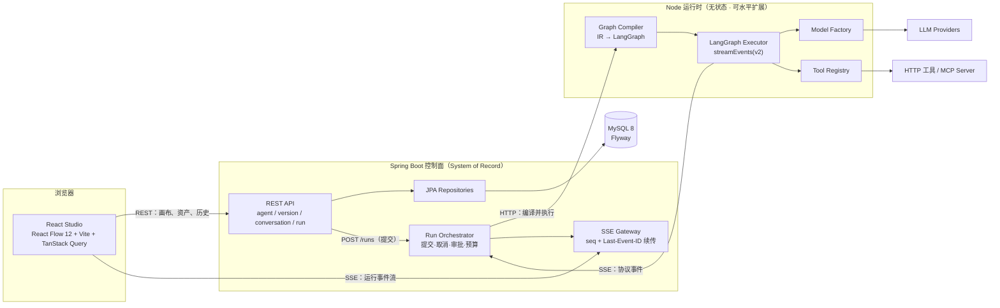
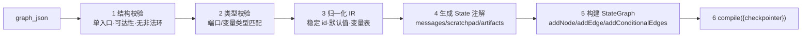
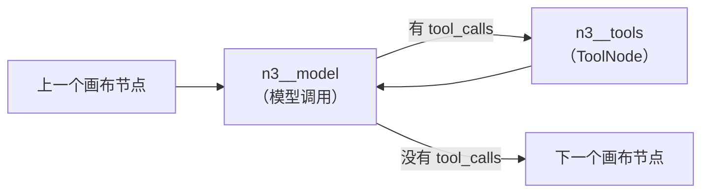

# Agent Stack · MVP 设计方案

> 一句话定位：**用 React Flow 画图 → 编译成 LangGraph 可执行图 → 用一条事件协议贯穿「执行 / 持久化 / 前端追踪」的 Agent 低代码平台。**

---

## 0. 实施结果（as-built）

本文最初是**设计稿**，描述的是一个比 MVP 更大的系统。实际交付的版本在此基础上做了大幅收缩，
理由统一是：**把预算从"平台功能的广度"挪到"一条 run 的纵深"**。

| 维度 | 设计稿 | 实际交付 | 差异原因 |
|---|---|---|---|
| 节点类型 | 9 种（含 condition / map / approval / agent） | **4 种**：`start` / `prompt` / `llm` / `end` | 验收标准是"能保存并运行一个 agent"。分叉与环会让校验与前端复杂度翻倍；`approval` 强制要求持久化 checkpointer |
| 数据表 | 13 张 | **5 张**：`agent` / `conversation` / `run` / `message` / `run_event` | 版本管理、checkpoint、interrupt、凭证、用量统计都不是主链路依赖 |
| 工具循环 | `agent` 节点用 `createReactAgent` | **在编译期把 LLM 节点展开成 `model → tools → model` 回边** | 画布保持 DAG（用户不用画循环），运行时仍有完整 ReAct 循环；且事件归属到画布节点更干净。**详见 §5.5** |
| 条件表达式 | 受限 AST 求值器 | **未实施**（无 condition 节点） | 随节点类型一起砍掉 |
| HITL 审批 | `interrupt()` + `Command(resume)` | **未实施**，`checkpointer` 作为编译器参数预留 | 需要持久化 checkpointer（多 2 张表 + 审批 UI + resume 端点） |
| checkpoint | 自定义 `BaseCheckpointSaver` 落 MySQL | **不用 checkpointer**，运行时完全无状态 | 会话历史由 MySQL 持有、每次 run 全量下发 → runtime 重启/多副本都不丢会话，这才配得上"独立部署"。见 §2.2 ADR-3 |
| Java 契约 | jsonschema2pojo 生成 10 个事件类型 | **只对信封建模**，`payload` 原样转发 + fixture 契约测试 | 契约漂移面从 10 个事件缩到 1 个信封。见 §2.2 ADR-6 |
| 集成测试 | Testcontainers | **直连项目自带 MySQL 实例** | 开发机没有 Docker |
| 前端依赖 | react-router + 多页面 | **单屏三区，不引路由** | 只有两页需求，不值得一层抽象 |
| 未实施 | MCP、动态 OpenAPI 工具、RBAC、向量检索、DAG 自动布局、run 对比、Playwright | 见 §14 与 README 的"明确不做" | — |

**实际验证结果**：三层测试 97 个用例全绿；`scripts/e2e.sh` 38 项断言全通过；
一条真实 run 产出 54 条事件、`seq` 1..54 无重复，`calculator` 算出 `(12+8)*3 = 60`。

以下各节保留设计稿原文（含 Part 2 未实施部分的推演），但**实现细节以代码与
[`docs/PROTOCOL.md`](PROTOCOL.md) / [`README.md`](../README.md) 为准**；
被砍掉的部分在末尾 §14 汇总。

---

本方案的核心不是"接一个大模型 API"，而是把 **Agent Harness（智能体运行时外壳）** 当成可设计、可观测、可恢复的一等工程对象来做。文档里每个卖点都对应到「具体 API + 落到哪一层 + 有什么证据」。

---

## 1. 要证明的三件事（设计主线）

| # | 命题 | 反面教材 | 本项目的落点 |
|---|---|---|---|
| 1 | 画布图不是"配置"，是**中间表示（IR）**，需要编译 | 前端 JSON 直接透传给后端逐字段 if-else 调模型 | `GraphCompiler`：校验 → 归一化 → `StateGraph` → `compile()`，编译器有 golden-file 单测 |
| 2 | **Harness 是产品主体**，模型只是其中一个可替换零件 | 只有"输入→LLM→输出"的聊天壳 | 8 项 harness 职责各自独立成模块 + 单测 + **在 UI 上有可见证据**（第 8 节） |
| 3 | 契约优先：**一条协议**，三端共用 | 前端猜字段、后端改字段炸前端 | `contracts/*.schema.json` 单一真源 → 生成 TS 类型与 Java record + fixtures 回放式契约测试 |

---

## 2. 系统架构



### 2.1 职责划分（关键：边界要能讲清楚）

| 层 | 负责 | 明确不负责 |
|---|---|---|
| **Java 控制面** | Agent/版本资产、会话与消息、Run 生命周期、**事件日志（append-only）**、Checkpoint 落库、审批状态机、凭证与审计、token/预算配额 | 不参与单步推理，不做 prompt 拼接 |
| **Node 运行时** | 图编译与校验、LangGraph 执行、模型/工具适配、事件产出、能力清单自注册 | 不持久化业务状态（除内存 checkpoint），不做鉴权 |
| **React Studio** | 画布与检查器、schema 驱动表单、调试台与回放、版本管理 | 不做业务校验的唯一出处（服务端必须复校） |

### 2.2 架构决策记录（ADR 摘要）

- **ADR-1 执行权归 Node**：Agent Loop 必须在 LangGraph 内闭环。`interrupt()`/`Command({resume})`、checkpointer、`streamEvents` 都是"循环级"能力，若让 Java 逐步驱动模型调用，这些能力会全部退化成手写状态机 —— 那就恰好丢掉了要展示的东西。
  *备选*：Java 主导循环、Node 只做 `invoke`（不选，见上）。
- **ADR-2 用 SSE + JSON 而非 gRPC/WebSocket**：可读、可 curl 复现、可入库回放、浏览器原生支持、契约测试简单。代价：单向流；审批走独立 REST 接口回传。
- **ADR-3 Checkpoint 归属**：MVP 用 `MemorySaver` + Java 侧事件溯源（保证 run 可回放、UI 可重放）；**进阶加分项**是实现自定义 `BaseCheckpointSaver` 把 checkpoint 通过 Java API 落到 MySQL —— 这是真正的"深水区"，但放在 Tier 3，不阻塞 MVP。
- **ADR-4 图 schema 版本化 + migrator**：`graph_json` 带 `schemaVersion`，加载时过 migrator 链，保证老图不炸（对"低代码平台"是刚需，也体现长期维护思维）。
- **ADR-5 模型抽象用注册表 + 凭据引用**：`ModelFactory.create({provider, model, temperature, credentialRef})`；内置 **FakeModel**（确定性输出）让全链路与 CI **不需要任何 API key** 就能跑通 —— 这是能持续验证的前提。

---

## 3. 领域模型（MySQL 8 / Flyway）

| 表 | 关键字段 | 设计意图 |
|---|---|---|
| `agent` | id, name, slug, description, current_version_id, status | 资产主体 |
| `agent_version` | id, agent_id, version_no, **graph_json**, schema_version, node_manifest_hash, published_at | 图快照 + 可回滚；manifest_hash 保证运行时能力变更可检测 |
| `node_type_capability` | type, display_name, category, config_schema_json, ports_json, version | 运行时上报、Studio 渲染表单的唯一来源（**能力驱动 UI**） |
| `conversation` | id, agent_id, title, thread_id, created_at | 会话 = LangGraph thread |
| `message` | id, conversation_id, run_id, role, content, tool_calls_json, usage_json | 面向 UI 的最终消息 |
| `run` | id, conversation_id, agent_version_id, status, trigger, started_at, finished_at, error_json, idempotency_key | 一次执行；幂等键防重复提交 |
| `run_event` | id, run_id, **seq**, type, node_id, payload_json, ts | **append-only**；唯一索引 `(run_id, seq)`，是回放与审计的真源 |
| `checkpoint` | thread_id, checkpoint_ns, checkpoint_id, parent_checkpoint_id, type, state_json, metadata_json | 为 ADR-3 的进阶实现预留；MVP 亦可写"轻量快照" |
| `interrupt` | id, run_id, node_id, kind, payload_json, status, resolved_by, resolved_at | HITL 审批状态机（pending/approved/rejected/expired） |
| `tool_invocation` | id, run_id, node_id, tool_name, args_json, result_json, status, duration_ms, error_json | 工具可观测性 |
| `llm_usage` | id, run_id, node_id, model, provider, input_tokens, output_tokens, latency_ms, cost_micros | 成本与性能面板 |
| `credential` | id, provider, name, cipher_text, kek_version | AES-GCM 加密，**永不回显** |

要点：`run_event` 用 `(run_id, seq)` 做唯一约束 + 覆盖索引，所有查询走 `run_id + seq > ?`，天然支持 `Last-Event-ID` 断线续传。

---

## 4. 事件协议（本项目的骨架）

### 4.1 为什么值得单独设计

一条协议同时解决四个问题：**流式渲染、断线续传、执行回放、跨语言契约**。它是"harness 思想"最直观的物化。

### 4.2 事件目录

| 事件 | 载荷要点 |
|---|---|
| `run.started` | run_id, agent_version, model, input |
| `node.started` / `node.finished` | node_id, node_type, duration_ms |
| `llm.started` | model, message_count, prompt_tokens_est |
| `llm.token` | node_id, delta（可选降采样） |
| `llm.completed` | usage{input,output,total}, finish_reason |
| `tool.call.started` | tool_name, args, call_id |
| `tool.call.result` | call_id, result（截断标记）, error? |
| `state.update` | node_id, changed_keys（scratchpad/artifacts 增量） |
| `interrupt.requested` | interrupt_id, node_id, kind, payload（审批内容） |
| `interrupt.resolved` | interrupt_id, decision, resolved_by |
| `checkpoint.saved` | checkpoint_id, parent_id, ns |
| `budget.warning` | kind(tokens/steps), used, limit |
| `run.error` | 分类码 + 用户可读文案 + `retryable` |
| `run.finished` | status, total_usage, total_ms |

### 4.3 映射：LangGraph `streamEvents(v2)` → 协议事件

| LangChain 回调事件 | 协议事件 | 备注 |
|---|---|---|
| `on_chain_start`（图根） | `run.started` | 用 `config.metadata.thread_id` 关联会话 |
| `on_chain_start`（节点） | `node.started` | 节点名需可逆映射回画布 `node_id`（编译时写进 `config.metadata`） |
| `on_chat_model_start` | `llm.started` | |
| `on_chat_model_stream` | `llm.token` | `chunk.content` 可能是 `ContentBlock[]`，需归一化 |
| `on_chat_model_end` | `llm.completed` | 取 `usage_metadata`，缺失时回退 tokenizer 估算 |
| `on_tool_start` / `on_tool_end` | `tool.call.started` / `tool.call.result` | 错误路径补 `on_tool_error` |
| `on_chain_error` | `run.error` / `node.error` | 分类：可重试 / 用户错误 / 上游配额 / 内部 |
| `on_custom_event` | 自定义域事件 | 用 `config.writer` 发 `checkpoint.saved`、`state.update` 等 |
| `__interrupt__`（`graph.stream` 产出） | `interrupt.requested` | 与 `getState().tasks[].interrupts` 交叉校验 |

> 实现细节：事件映射器是一个纯函数（`(langchainEvent, ctx) => ProtocolEvent[]`），因此**可以脱离模型单测**，用录制好的 fixture 回放断言 —— 这正是把这个模块做成"可验证"的关键。

### 4.4 传输与续传

```text
POST /api/runs            → 202 {run_id}            # 提交（幂等键）
GET  /api/runs/{id}/events?afterSeq=42   (SSE)      # 事件流，Last-Event-ID 兼容
GET  /api/runs/{id}/events/page?page=0   (REST)     # 长历史分页兜底
POST /api/runs/{id}/interrupts/{iid}     → approve/reject
POST /api/runs/{id}/cancel
POST /api/runs/{id}/resume?fromCheckpoint=xxx
```

---

## 5. 图模型与编译

### 5.1 节点类型（v1 只做 9 种，克制是特性）

| 类型 | 作用 | 编译为 |
|---|---|---|
| `start` | 入口，声明输入变量 schema | `START` 边 |
| `prompt` | 模板渲染节点 | 纯函数节点 |
| `llm` | 模型调用 + 结构化输出 | 模型节点（`bindTools` 可选） |
| `agent` | 预置 ReAct 子图（多轮工具循环） | `createReactAgent` 子图 |
| `tool` | 单次确定性工具调用 | 工具节点（无模型参与） |
| `condition` | 可视化规则分支（≥2 出口） | `addConditionalEdges` |
| `map` | 列表遍历（有界并发） | `Send` / 子图 fan-out |
| `approval` | 人工审批（HITL） | 节点内 `interrupt()` |
| `end` | 汇总输出、声明输出 schema | `END` 边 |

### 5.2 编译流水线



校验规则（服务端与前端各实现一遍，服务端为准）：单一 `start`、至少一个 `end`、所有节点从 `start` 可达、非 `map` 子图内不允许环、`condition` 每条出口不可为空、变量引用必须在该节点上游已声明、工具名必须存在于该 agent 版本授权的工具集、端口类型兼容。

### 5.3 统一 State（体现 reducer / channel 理解）

```ts
export const AgentState = Annotation.Root({
  messages: Annotation<BaseMessage[]>({
    reducer: messagesStateReducer,      // 追加 + 按 id 去重更新（工具消息回填）
    default: () => [],
  }),
  input: Annotation<Record<string, unknown>>({ reducer: (_p, n) => n, default: () => ({}) }),
  scratchpad: Annotation<Record<string, unknown>>({
    reducer: (p, n) => ({ ...p, ...n }), // 浅合并：节点间传值
    default: () => ({}),
  }),
  artifacts: Annotation<Artifact[]>({
    reducer: (p, n) => p.concat(n),      // 累积：报告/引用/中间产物
    default: () => [],
  }),
  budget: Annotation<Budget>({
    reducer: (p, n) => ({ tokens: p.tokens + n.tokens, steps: p.steps + n.steps }),
    default: () => ({ tokens: 0, steps: 0 }),
  }),
  approval: Annotation<Approval | null>({ reducer: (_p, n) => n, default: () => null }),
});
```

### 5.4 图 JSON → LangGraph（骨架）

```ts
export function compileGraph(graph: AgentGraph, deps: RuntimeDeps): CompiledAgent {
  const g = new StateGraph(AgentState);

  for (const node of graph.nodes) {
    g.addNode(node.id, makeNodeRunner(node, deps), {
      // 让 LangGraph 知道所有可能的后继，才能正确合并并行分支
      ends: successorsOf(graph, node.id).map((e) => e.to),
      metadata: { displayName: node.displayName, nodeType: node.type }, // 回传给事件映射器
    });
  }

  g.addEdge(START, graph.entryNodeId);
  for (const edge of graph.edges) {
    if (edge.kind === 'always') {
      g.addEdge(edge.from, edge.to);
    } else {
      g.addConditionalEdges(edge.from, buildRouter(edge, graph), targetsOf(edge));
    }
  }
  for (const node of graph.nodes.filter((n) => n.type === 'end')) g.addEdge(node.id, END);

  return { graph: g.compile({ checkpointer: deps.checkpointer }), ir: normalize(graph) };
}
```

两个刻意的工程决定：

1. **`condition` 不用 `eval`**：UI 的可视化规则构造器产出 **受限表达式 JSON**（`{op:'and', args:[{op:'gt', left:{ref:'scratchpad.score'}, right:5}]}`），运行时有白名单 AST 求值器。安全性 + 可静态校验 + 可单测，三赢。
2. **节点名映射**：LangGraph 内部节点 id 与画布 id 一致，`config.metadata` 带 `node_type/display_name`，让事件映射器无需查库即可产出前端能直接高亮的事件。

### 5.5 实际实现：LLM 节点的工具循环在编译期展开（本节是 as-built，不是设计稿）

设计稿原本让 `agent` 节点直接调用 `createReactAgent`。实际实现改成了一个更干净的做法，
也是整个项目里最能体现 LangGraph 理解的一处设计：



**画布是 DAG，运行时可以带环。** 用户永远只需要画一条直线（不需要理解、也不需要平台支持"环"这种
极容易画错的图），而 Agent 拿到的仍然是完整的 ReAct 工具循环。

这个选择换来了三件具体的好处：

1. **不需要在 IR 里支持环** —— 校验规则里"非 end 节点恰好一条出边"这一条就能同时挡住分叉与环；
2. **事件归属干净** —— `n3__model` 与 `n3__tools` 都映射回画布节点 `n3`，前端看到的是"大模型这个节点
   在忙（包括它在调工具）"，而不是两个幽灵节点在闪；
3. **`node.finished` 的时机可以精确** —— LLM 节点的"做完"被定义为 *model 这一轮没有产生 `tool_calls`*，
   于是画布上的高亮会一直持续到工具循环真正结束，而不是在第一次模型返回时就熄灭。

实现里还有两处必须注意的细节（都有回归测试）：

- **路由函数自己写，不用 prebuilt 的 `toolsCondition`**：它的实现是 `return "tools"`（硬编码节点名），
  一张图里有多个 LLM 节点时必然冲突。
- **判断"节点是否在跑"只能看 run 自己的 `name`，不能看 `metadata.langgraph_node`**：
  LangGraph 会在节点内部再包一层 `RunnableLambda`，它的 `langgraph_node` 与节点同名。
  早期版本用 metadata 判断，结果工具调用**之前**就发了 `node.finished`，前端表现为节点闪烁。

最后，工具循环失控由 `recursionLimit` 熔断（按图的节点数与 `maxSteps` 计算），
触发后收敛成 `run.error(STEP_LIMIT)` + `run.finished(FAILED)`。

---

## 6. 工具系统

- **内置工具**：`calculator`、`http.get`（**域名白名单 + 超时 + 响应截断**）、`json.extract`、`knowledge.search`（MVP 用 MySQL FULLTEXT，不引入向量库）。
- **动态工具**：从 OpenAPI/JSON Schema 描述生成 `DynamicStructuredTool`（zod 校验入参），Studio 里可粘贴 spec 自动生成工具。
- **MCP 适配**（Tier 3 加分）：`@langchain/mcp-adapters` 接入外部 MCP server，展示对生态的理解。
- **权限模型**：`{name, mode: 'allow' | 'deny' | 'ask', timeoutMs}`，**默认 deny**，需在 agent 版本中显式授权；`ask` 直接触发 `interrupt()` 复用 HITL 通道。
- **错误不炸循环**：工具异常包装成 `ToolMessage`（带结构化错误码）回灌给模型，让 Agent 有机会自我修正 —— 这是 harness 与"裸调 API"的分水岭。

---

## 7. Harness 能力矩阵（8 项职责 → 落点 → 证据）

| # | 职责 | 实现手段（LangChain/LangGraph 具体 API） | 测试证据 | UI 证据 |
|---|---|---|---|---|
| 1 | **执行循环** | `StateGraph` + 条件边 + 步数上限 | 图编译 golden 测试 | 画布节点逐个点亮 |
| 2 | **工具调度** | `tool()` / `DynamicStructuredTool` / `ToolNode` / `toolsCondition` | 工具单测 + 参数校验失败用例 | 工具调用卡片可展开参数与结果 |
| 3 | **上下文管理** | `trimMessages` / 摘要中间件 / 上下文编辑 | token 预算单测（超限必触发裁剪） | 显示"本轮上下文 tokens / 裁剪了几条" |
| 4 | **权限与 HITL** | 节点内 `interrupt()` + `Command({resume})` | 审批→批准/拒绝两条路径的集成测试 | 审批弹窗 + 画布停止高亮 |
| 5 | **可恢复性** | `checkpointer` + `getState()` + 从 checkpoint 重跑 | 中断后 resume 结果与不中断一致 | "从此节点重跑"按钮 + 事件回放 |
| 6 | **可观测性** | `streamEvents(v2)` + `config.metadata` 透传 + usage 落库 | 事件映射器 fixture 回放 | trace 时间线 + 原始事件 JSON |
| 7 | **错误与降级** | `.withRetry()` / `.withFallbacks()` / 错误分类 | 注入故障模型断言降级路径 | 错误卡片含分类码 + `retryable` 标识 |
| 8 | **预算与熔断** | `recursionLimit` + 自定义 token 累加 reducer + 超限降级 | 预算耗尽即终止且状态为 `budget_exceeded` | usage/耗时/token 面板 + 预算告警条 |

> 这张表就是"我理解 harness"的证据清单，也是面试时最该讲的一页。

---

## 8. 前端设计（React + React Flow 12）

**路由**：`/agents`（列表）、`/agents/:id/design`（画布）、`/agents/:id/versions`、`/runs/:id`（回放）、`/playground`（调试台）。

**画布**：节点渲染（自定义节点组件，按类别配色 + 状态灯）、连线校验（非法连接即时提示）、自动布局（dagre/elk）、minimap、多选与复制粘贴、撤销栈。

**检查器（能力驱动）**：节点表单**完全由后端 manifest 的 `config_schema_json` 生成**，新增节点类型只需运行时注册，Studio 不改代码 —— 这是"低代码平台"的架构底线。

**调试台**：左侧聊天流（token 流式）+ 右侧 trace 时间线（节点耗时瀑布）+ 画布实时高亮 + 原始事件 JSON 抽屉 + 审批弹窗 + 两次 run 对比（Tier 3）。

**状态管理**：TanStack Query 管 REST 缓存；**zustand + 纯函数 reducer 管事件流**（`reduce(state, event) => state`），因此事件回放 = 重新 reduce 一遍，可单测、可离线重放。

**连接韧性**：SSE 断线用 `Last-Event-ID` 续传，超过 N 次失败降级为分页轮询。

---

## 9. 契约与代码生成

```text
contracts/agent-graph.schema.json      # 画布图 IR
contracts/events.schema.json           # 协议事件（判别式联合）
contracts/node-manifest.schema.json    # 能力清单
contracts/fixtures/*.jsonl             # 事件流样例，契约测试用
        │
        ├── json-schema-to-typescript ──► packages/protocol/src/types.ts
        │                                  packages/protocol/src/reducer.ts（前端+运行时可复用）
        └── jsonschema2pojo（Maven 插件）─► java/agent-stack-contracts/…（Java record + Jackson）
```

生成物**提交进仓库**并在 CI 校验 `git diff --exit-code`，避免"生成物漂移"。

---

## 10. 目录结构

```text
agent-stack/
├── contracts/                     # 单一真源 JSON Schema + fixtures
├── packages/protocol/             # 生成类型 + 事件 reducer + zod validator（TS 侧共享）
├── apps/
│   ├── studio/                    # React 19 + Vite + React Flow 12
│   └── runtime/                   # Node 22 + TypeScript + LangChain v1 / LangGraph
│       └── src/{compiler,executor,models,tools,events,server}/
├── java/
│   ├── pom.xml                    # parent
│   ├── agent-stack-contracts/     # 生成的协议类型
│   └── agent-stack-server/        # Spring Boot 3.x + JPA + Flyway + SSE
│       └── src/main/{java,resources/db/migration}
├── infra/                         # docker-compose、Makefile、seed 数据
├── docs/                          # DESIGN.md、PLAN.md、ADR/、PROTOCOL.md、DEMO.md
└── .github/workflows/ci.yml
```

---

## 11. 可观测性与运维

- `run_id`/`trace_id` 跨 Java↔Node 透传（HTTP header + 日志 MDC/child logger），一条 run 的两端日志可 grep 串起来。
- 指标：run 成功率、p95 时长、token/run、工具失败率、中断率；Spring Actuator + 运行时 `/healthz` + `/readyz`（含能力清单与模型连通性自检）。
- LangSmith **可选**（env 开关），默认关闭；本地 trace 面板自足，保证离线可演示。

## 12. 安全

凭证 AES-GCM 加密 + 本地 KEK、永不回显；工具默认 deny + 域名白名单（防 SSRF）；表达式白名单求值（不 eval）；工具/网页返回内容**标记为不可信数据**并在系统提示中声明（prompt injection 缓解）；审计日志记录每次发布/审批/凭证使用。

## 13. 测试策略

| 层 | 手段 | 覆盖重点 |
|---|---|---|
| 单元 | Vitest | 图编译 golden 文件、条件表达式求值、事件映射器、模板变量解析、事件 reducer |
| 集成 | JUnit 5 + Testcontainers(MySQL) | Flyway 迁移、run 状态机、SSE 续传、审批事务 |
| 端到端 | Vitest + FakeModel | 无 API key 跑通含 `interrupt` 的完整 run，断言事件序列 |
| 契约 | fixtures 回放 | Node 产出的事件 Java 能解析、Java 存的事件前端能 reduce |
| UI 冒烟 | Playwright | 拖节点→连线→保存→试跑→看到高亮 |

## 14. MVP 明确不做（防止范围蔓延）

多租户与完整 RBAC、多人协作/实时协同编辑、自建向量库与 RAG 平台化、插件市场、计费、图的热更新、跨语言 SDK、Windows 一键安装包。

## 15. 版本 pin（实测 npm registry，2026-02 核查）

| 包 | 版本 |
|---|---|
| `langchain` | 1.5.15 |
| `@langchain/core` | 1.2.17 |
| `@langchain/langgraph` | 1.4.21 |
| `@langchain/openai` | 1.6.2 |
| `@langchain/anthropic` | 1.5.12 |
| `@langchain/langgraph-checkpoint-sqlite` | 1.0.4 |
| `@langchain/langgraph-checkpoint-mysql` | 存在但**无 `latest` 标签**（未正式发版）→ 佐证 ADR-3 |
| `@xyflow/react` | 12.12.0 |
| `zod` | 4.6.5 |

> LangChain v1 引入了 `createAgent` + middleware（`createMiddleware`、`HumanInTheLoopMiddleware`、`SummarizationMiddleware`、`ModelCallLimitMiddleware` 等）。**M0 阶段用 0.5 天做 API spike 固化实际可用的签名与版本**，并锁定 lockfile；文档与代码以实测为准，不以记忆为准。

## 16. 环境现状（本机实测）

| 依赖 | 状态 |
|---|---|
| Node / npm | ✅ v24.19.0 / 11.17.0 |
| pnpm | ✅ 11.7.0 |
| JDK | ❌ `/usr/bin/java` 为占位 stub（"Unable to locate a Java Runtime"） |
| Maven / Gradle | ❌ 均未安装 |
| Docker / podman | ❌ 未安装 |
| MySQL | ❌ 未安装（`sqlite3` 存在） |
| Homebrew | ❌ 未安装 |

**开工路径建议（推荐 C 起步 → B 收尾）**：

- **C 零阻塞起步**：装 Temurin JDK 21 + 提交 **Maven Wrapper（`mvnw`）**（不需要全局装 Maven），本地 dev profile 用 **H2 MySQL 兼容模式**跑；CI 用 **MySQL 8 service container** 验证真实方言。
- **B 收敛**：交付前装 MySQL 8 官方安装包，`mvnw flyway:migrate` 在真 MySQL 上跑通全链路。**"用 MySQL 存储"这条要求必须在真 MySQL 上验收，不能只跑 H2。**
- **A 最省心**：装 Docker Desktop，`docker compose up mysql` 一键起库（需额外下载安装）。
