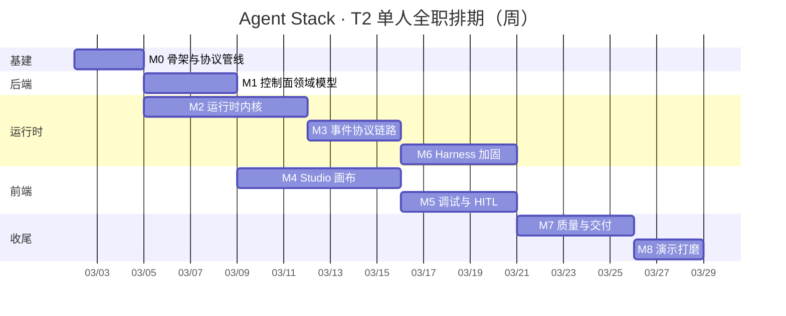

# Agent Stack · MVP 实施计划与工期预估

> 估算是 **person-days（人日，按 1 人全职 6 小时有效工时/天）**。沟通、环境折腾、返工已按 15% 计入各模块。

---

## 0. 实际完成情况（as-built）

本计划的第一版把范围定成"T2 完整 MVP ≈ 42 人日"，随后按"不过度设计"重新收敛为
**22.5 人日的单层 MVP**，并真实执行完毕。对照如下：

| 阶段 | 计划内容 | 实际状态 |
|---|---|---|
| S0 工具链 | 项目内 JDK/Maven/MySQL，零 sudo | ✅ 完成。JDK 21.0.12.1 + Maven 3.9.11 + **真实 MySQL 8.4.7** 全部落在 `.toolchain/` |
| S1 契约与骨架 | contracts 真源 + codegen + 三目录 | ✅ 完成。3 份 JSON Schema → TS 类型双向生成，Java 侧只建模信封 |
| S2 持久化 | 5 张表 + agent CRUD | ✅ 完成。Flyway 在真 MySQL 上迁移，含 `JSON_LENGTH` 直查验证 |
| S3 runtime | 编译器 + 模型 + 工具 + NDJSON | ✅ 完成。`npm run run-graph` 可脱离 Java/前端单独跑通一次 run |
| S4 编排与 SSE | 虚拟线程消费流 + seq 落库 + 续传 | ✅ 完成。`afterSeq` 续传经 e2e 断言（恰好返回 seq 51–54） |
| S5 画布 | React Flow + manifest 驱动表单 | ✅ 完成。Vite 编译通过、生产构建成功；**交互未在浏览器中人工验证**（见下） |
| S6 运行面板 | SSE + reducer + 流式 + 节点高亮 | ✅ 完成。reducer 13 个用例 + 回放真实录制事件流 |
| S7 测试与交付 | 三层测试 + e2e + 文档 + Dockerfile | ✅ 完成。**97 个测试用例 + 38 项 e2e 断言全绿**；Dockerfile 与 compose 未经构建验证 |
| 未完成项 | — | HITL/interrupt、版本管理、condition/map/agent 节点、MCP、Playwright |

**计划中"人日"与实际的差异说明**：本项目的编码是由 AI 结对完成的，因此"人日"在这里的
意义是**工作量量级**（用于判断这是一个多大体量的项目、以及给别人估工期时的参考），
而不是本次实际消耗的日历时间。

### 计划与实现之间的三处重要偏离

| 偏离 | 原因 |
|---|---|
| 工具循环从"`agent` 节点 + `createReactAgent`"改为"**LLM 节点编译期展开成回边**" | 画布保持 DAG，用户不需要画环；事件能准确归属到画布节点；避免了子图流式事件的归属问题 |
| 集成测试从 Testcontainers 改为**直连项目自带 MySQL** | 开发机没有 Docker。反而更贴近部署形态，也让"用 MySQL 存储"可被字面验证 |
| 前端不引路由库、不做多页面 | 只有"列表 + 画布 + 运行面板"三个区，单屏足够 |

### 已知局限（必须知道，不要当成已解决）

1. **前端交互没有经过真人浏览器验证**。已验证的是：Vite 能编译全部源码、生产构建成功、
   `/api` 代理可用、**通过 Vite 代理完整跑通了一次 run**（工具结果 `(3+4)*5 = 35`）。
   未经真人验证的是：拖拽手感、布局观感、节点高亮的视觉效果。
2. **Dockerfile 与 docker-compose.yml 未经构建验证**（无 Docker 环境），仅经人工审查。
3. **Flyway 对 MySQL 8.4 报"版本比它认识的更新"警告**（支持到 8.1），迁移功能正常。
4. **token 数是按 4 字符 ≈ 1 token 估算的**，UI 上已明确标注；接入真实模型后 OpenAI 会返回
   `usage_metadata`，届时走真实计数。

---

---

## 1. 结论先行

| 方案 | 范围 | 人日 | 1 人全职 | 1 人业余(20h/周) | 2 人并行 |
|---|---|---|---|---|---|
| **T1 可演示最小闭环** | 画布 → 编译 → 执行 → 流式追踪，无审批/无加固 | **22–25 pd** | 4.5–5 周 | 8–9 周 | 2.5–3 周 |
| **T2 完整 MVP（推荐）** | T1 + HITL 审批 + harness 加固 + 质量与交付 | **40–45 pd** | 8–9 周 | 13–15 周 | 5–5.5 周 |
| **T3 作品集加强版** | T2 + 自定义 MySQL CheckpointSaver + MCP 工具 + run 对比 + 真实检索 | **50–56 pd** | 10–11 周 | 16–18 周 | 6–7 周 |

**推荐目标：T2。** 理由：T1 缺 HITL 与加固，讲不出"harness"；T3 的边际收益集中在个别炫技点，性价比低于把 T2 做扎实。

---

## 2. 里程碑与交付物

| 里程碑 | 交付物 | 验收标准 | 人日 |
|---|---|---|---|
| **M0 环境与骨架** | monorepo、mvnw + JDK21、Spring Boot 骨架、Flyway 首版迁移、SSE 打通、**协议 codegen 管线**、CI 首发、**LangChain v1 API spike** | `make dev` 一键起；`curl /actuator/health` 200；`pnpm build` + `mvnw verify` 绿；契约生成物 CI 校验不漂移 | 2.5 |
| **M1 控制面领域模型** | 13 张表 Flyway v1、agent/version CRUD、发布与校验、conversation/message/run/run_event、分页与幂等 | Testcontainers 集成测试通过；提交重复幂等键只产生 1 个 run | 4 |
| **M2 运行时内核** | 能力清单握手、GraphCompiler（6 类校验 + IR）、9 种节点编译、统一 State、ModelFactory（含 FakeModel）、ToolRegistry（内置 4 + 动态 HTTP + 权限判定） | 编译器 golden 测试 ≥12 个图例；FakeModel 下任一合法图可跑完 | 7 |
| **M3 事件协议链路** | `streamEvents(v2)` → 协议事件映射器、seq 编号、Node→Java SSE、Java→浏览器 SSE 转发与持久化、`Last-Event-ID` 续传、前端 run reducer | fixture 回放断言全绿；手动断网 10s 后事件不丢不重 | 4 |
| **M4 Studio 画布** | React Flow 画布、自定义节点、连线校验、自动布局、manifest 驱动检查器表单、变量选择器、保存/加载/版本发布/列表页 | 新增一个节点类型只改运行时 manifest，Studio 零改动即可渲染表单 | 7 |
| **M5 调试与 HITL** | 聊天流式面板、trace 时间线、画布实时高亮、原始事件抽屉、审批弹窗（approve/reject）、从 checkpoint 重跑 | 端到端 demo 剧本完整跑通；reject 路径状态正确落库 | 5 |
| **M6 Harness 加固** | 重试/降级/超时/取消（AbortSignal 贯穿）、上下文裁剪+摘要、token 预算与 usage 落库、错误分类、trace_id 透传、指标与健康检查 | 注入故障模型断言降级；预算耗尽以 `budget_exceeded` 终止；取消后无悬挂请求 | 5 |
| **M7 质量与交付** | 单测补齐、契约测试、E2E、Playwright 冒烟、Docker/compose、Makefile、种子 demo agent、README/ARCHITECTURE/ADR/PROTOCOL 文档 | 干净环境 clone → `make demo` 5 分钟内可演示；CI 全绿 | 5 |
| **M8 演示打磨** | 演示脚本、录屏、3 个示例 agent、空态/加载/错误态 UI | 3 分钟无冷场演示；无控制台报错 | 2.5 |
| | | **合计** | **42** |

---

## 3. 排期（关键路径）

**关键路径**：`M0 → M2 → M3 → M6 → M7 → M8`（≈ 26 pd 串联）。
**正浮动**：M4/M5 前端线依赖 M1 + M3 的事件契约，是第二条长链（≈ 12 pd）。

**若 2 人并行（1 前端 + 1 后端/运行时）**：M4/M5 与 M1/M2/M6 几乎完全重叠，工期 ≈ **5–5.5 周**。前提是 **M0 必须先把契约钉死**，否则前端会被协议变更返工吃掉收益 —— 这是并行化的唯一硬约束。

---

## 4. 三次削峰：如何在 2 周内先拿到"能演示的东西"

如果需要在两周内先有一个能给人看的版本，按这个顺序砍（每砍一刀都要在 README 记录）：

| 砍掉的 | 省下 | 代价 |
|---|---|---|
| 9 种节点 → 5 种（start / prompt / llm / tool / end） | −3 pd | 无分支无循环，但主链路完整 |
| 版本管理 → 编辑即保存 | −2 pd | 无回滚，图仍有 `schemaVersion` |
| 动态 HTTP 工具 → 只留内置 4 个 | −2 pd | 少一个"平台感"卖点 |
| 事件回放/时间线 → 只保留聊天流式 + 节点高亮 | −2.5 pd | 砍掉最漂亮的调试能力，建议最后再砍 |
| 测试只覆盖编译器 + 事件映射器 | −3 pd | CI 绿但信心下降 |

砍完 ≈ **14–16 pd（3 周全职 / 5 周业余）**，之后按 M5 → M6 → M7 顺序补回。

---

## 5. 风险登记

| 风险 | 概率 | 影响 | 缓解 |
|---|---|---|---|
| LangChain v1 API 与记忆/文档不一致 | 高 | 中 | M0 用 0.5d spike 固化版本与签名，锁 lockfile，**以实测为准** |
| 图编译器范围膨胀（嵌套子图、复杂分支） | 高 | 高 | v1 硬性只支持 9 种节点；`condition` 仅 2 出口；子图放 Tier 3 |
| 两端协议漂移 | 中 | 高 | JSON Schema 单一真源 + 生成物 CI diff 校验 + fixtures 回放 |
| SSE 大数据量/断线/背压 | 中 | 中 | `llm.token` 可降采样；seq + `Last-Event-ID`；分页 REST 兜底 |
| checkpoint 双写一致性（Tier 3） | 中 | 高 | Tier 3 才做；要求 saver 幂等 + 以 Java 为真源，冲突以 seq 大者胜 |
| HITL 跨进程 resume 时序 | 中 | 中 | MVP 用 `MemorySaver` + thread 亲和路由；文档写明水平扩展的前置改造点 |
| 本机无 JDK/Docker/MySQL/Homebrew | **确定** | 中 | 路径 C 起步（mvnw + H2），CI 用 MySQL service，交付前收敛到真 MySQL |
| 范围蔓延 | 高 | 高 | 第 14 节"明确不做"清单 + DoD 逐条勾选 |

---

## 6. Definition of Done（逐条勾选才算完成）

- [ ] 干净环境按 README 能起全栈（≤10 分钟），`make demo` 可跑
- [ ] 画布可创建、连线、校验、保存、发布版本
- [ ] 9 种节点全部可编译执行，编译器 golden 测试 ≥12 例
- [ ] FakeModel 下含 `interrupt` 的端到端 run 通过（**无需任何 API key**）
- [ ] 事件流可续传：断线后不丢不重
- [ ] 审批 approve/reject 两条路径均可复现并落库
- [ ] usage/token/耗时可视化，预算超限可终止
- [ ] 契约生成物与 fixtures 契约测试在 CI 中通过
- [ ] ARCHITECTURE.md 含 ADR，PROTOCOL.md 与代码一致
- [ ] 在**真 MySQL 8** 上完成一次完整验收（不能只有 H2）

---

## 7. 3 分钟演示剧本（同时也是验收脚本）

1. 新建 Agent → 拖 7 个节点：`start → prompt → llm → tool(http.get) → approval → llm → end`
2. 用变量选择器把 `{{scratchpad.http_result}}` 插进第二个 prompt 模板（**展示变量系统**）
3. 点"试跑" → **token 逐个流式吐出** → 画布上节点**逐个点亮**
4. 展开工具调用卡片：看到参数、耗时、结果与截断标记（**展示工具可观测**）
5. 命中 `approval` 节点 → 画布停止并高亮 → 弹窗显示待批内容 → 点"批准" → **从 checkpoint 继续**
6. 结束后看 usage / token / 耗时面板；打开原始事件 JSON 抽屉
7. 点"从此节点重跑" → 展示**可恢复性**
8. 发布 v2，回到历史 run 列表**回放**一次旧执行

> 讲解主线固定为："画布是 IR → 编译器保证合法性 → 运行时是我实现的 harness（8 项职责）→ 一条协议让执行过程在 UI 上可见、可回放、可干预。"

---

## 8. 每周节奏建议（单人）

| 周 | 目标 | 周末必须可演示 |
|---|---|---|
| W1 | M0 + M1 开始 | `/actuator/health` + agent CRUD + Flyway 表齐全 |
| W2 | M2 | 命令行喂一份 graph_json，FakeModel 跑完并打印事件 |
| W3 | M3 + M4 开始 | `curl -N /events` 看到完整事件流 |
| W4 | M4 | 浏览器里能画图、保存、加载 |
| W5 | M5 | 首次端到端：画图 → 试跑 → 高亮 → 审批 |
| W6 | M6 | 故障注入演示降级；断线续传演示 |
| W7 | M7 | 干净环境 10 分钟起全栈 + CI 绿 |
| W8 | M8 | 3 分钟演示无冷场，文档齐备 |

---

## 9. 能力映射（这份代码要证明什么）

| 招聘方关注点 | 本项目对应证据 |
|---|---|
| LangChain 深度 | `StateGraph`/`Annotation`/reducer、`streamEvents(v2)` 语义映射、`interrupt`+`Command`、`createReactAgent`/`ToolNode`、`withRetry`/`withFallbacks`、`trimMessages`、`DynamicStructuredTool`、结构化输出、v1 middleware |
| Agent/Harness 理解 | 第 7 节能力矩阵，8 项职责各有模块 + 测试 + UI 证据 |
| 架构与契约能力 | JSON Schema 单一真源 + 双向 codegen + 契约测试 + ADR + 图 schema 迁移器 |
| 工程化 | monorepo、CI（JDK21+Node22+MySQL service）、Testcontainers、golden/契约/E2E 三类测试、可观测性、Docker 一键起 |
| 前端工程 | React Flow 12 + 能力驱动表单 + 事件 reducer 可重放 + SSE 续传 + 撤销栈 |
| 产品意识 | 3 分钟演示剧本、加载/空/错误态、明确不做清单 |
